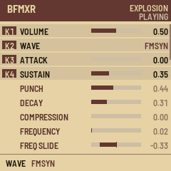
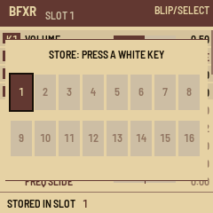

# BFXR for the M-VAVE FM-1

BFXR turns the FM-1 into [bfxr.net](https://www.bfxr.net)'s sound-effect maker: coins, lasers, explosions, power-ups,
hits, jumps and blips, made the way bfxr.net makes them and played from the keys.

**[Install it](https://nickhelliot.github.io/Bfm-1xr/install/)** · **[Try it in your browser](https://nickhelliot.github.io/Bfm-1xr/emu/)** · **[Library: your sounds on your computer](https://nickhelliot.github.io/Bfm-1xr/library/)**

---

## Install

1. Connect the FM-1 to your computer by USB and switch it on.
2. Open **https://nickhelliot.github.io/Bfm-1xr/install/** in Chrome or Edge. Allow MIDI access when the browser asks.
3. Press **Connect**, then **Install**. Keep the cable in and the tab open until it says it's done. The FM-1 restarts
   into BFXR: a cream screen with a maroon header.

If an install is interrupted, plug the FM-1 back in and press **Install** again: it carries on where it stopped.

To go back to M-VAVE's firmware or to another one, use the same page or the
[FM-1 Firmware Hub](https://thefirmwarehub.com). Installing firmware is at your own risk.

## The screen

- **Header:** BFXR, the slot you last stored or recalled (SLOT 3), the kind of sound you last made, and **PLAYING**
  while a sound plays.
- **The list:** bfxr's 32 parameters, each with a bar and its value. The bar fills from the left for settings that
  go from 0 up, and from the middle for settings that go both ways (up or down, faster or slower).
- **K1 to K4:** the four highlighted rows are the ones the four knobs change.
- **Footer:** what you just did (the value you changed, SAVED, MUTATED), or a reminder of the main buttons and the
  octave.

## The controls

| Control | What it does |
| --- | --- |
| **PRESET** | Picks a kind of sound and makes a new one, then plays it: PICKUP/COIN, LASER/SHOOT, EXPLOSION, POWERUP, HIT/HURT, JUMP, BLIP/SELECT, RANDOMIZE. Each click is a fresh sound |
| **EDIT** | Another new sound of the same kind. Press it until you hear one you like |
| **FX** | Mutate: nudges the sound a little in a random direction (and sometimes changes the wave) |
| **SELECT** | Scrolls the list. The four highlighted rows move with it |
| **K1 to K4** | Change the four highlighted rows. Turn slowly for fine steps (1 % of the range), fast for bigger ones |
| **ALGO** | Changes the wave, from anywhere in the list |
| **PLAY** | Plays the sound |
| **Keys** | Play the sound at a pitch. **C4** (the 5th white key from the left) plays it as made; the others transpose it |
| **OCT− / OCT+** | Shift the keys and PLAY down or up an octave (−2 to +2) |
| **HOME** | Jumps back to the top of the list |
| **SAVE** (tap) | Keeps the sound: it's there again the next time you switch on. SAVE is lit while there's something unsaved |
| **SAVE + a white key** | Stores the sound in that key's slot (16 slots, one per white key) |
| **SEL + a white key** | Recalls the sound from that key's slot and plays it |
| **MASTER** | Volume |

After you change a value, the sound plays once you stop turning, as bfxr.net plays when you let go of a slider.

**MIDI:** notes from USB play the sound (middle C at its own pitch), and the keys send notes out over USB.

## Making a sound

1. **Start from a kind.** Turn **PRESET** to the kind you want. Press **EDIT** until you hear something close.
2. **Nudge it.** Press **FX** a few times to try variations. If a variation is worse, press **EDIT** for a new start.
3. **Shape it.** Turn **SELECT** to the part you want to change and use **K1 to K4**. The useful places to start:
   - **Length:** ATTACK, SUSTAIN, DECAY.
   - **Pitch:** FREQUENCY, and FREQ SLIDE to make it rise or fall.
   - **Character:** the wave (**ALGO**), HARMONICS, LOWPASS, BIT CRUSH.
4. **Play it in tune.** Use the keys and **OCT− / OCT+** to hear it higher or lower.
5. **Keep it.** Hold **SAVE** and press a white key to store it in a slot, then make the next one.

## Storing sounds

BFXR has 16 slots, one for each white key, from the lowest (slot 1) to the highest (slot 16). They're kept when you
switch off.

- **Store:** hold **SAVE** and press a white key. The sound goes into that slot, replacing whatever was there.
- **Recall:** hold **SEL** and press a white key. The slot's sound comes back, ready to play and edit. Editing it
  doesn't change the slot until you store it again.
- **See what's where:** while you hold SAVE or SEL, the screen shows the 16 slots (filled: a sound stored, outlined:
  the slot you used last) and the white keys light up where a sound is stored.
- **Tap SAVE** on its own to keep just the sound you're editing, as before.

## Your sounds on your computer: the Library

The **[Library](https://nickhelliot.github.io/Bfm-1xr/library/)** page reads the slots from the FM-1 over USB.

1. Connect the FM-1 by USB with BFXR running, open the Library in Chrome or Edge, and press **Connect** (allow MIDI
   and SysEx when the browser asks). It reads the slots at once; **Read sounds** reads them again.
2. For each sound:
   - **Play** plays it on the computer.
   - **.bfxr** saves it as a bfxr.net file: drop it on [bfxr.net](https://www.bfxr.net) to keep editing it there.
   - **.wav** saves it as audio, ready for a game engine or a DAW.
   - **Clear** empties the slot on the FM-1.
3. **Download all (.zip)** saves every stored sound as both .bfxr and .wav in one file.
4. **Send** puts a .bfxr file from your computer into a slot, or into the sound you're editing ("Editing"). Make a
   sound on bfxr.net, save it with **Save .bfxr**, and send it to the FM-1. Only bfxr.net's Bfxr sounds can go to the
   FM-1, not its other synths.

The .wav files are rendered by bfxr's own code, so they sound as on bfxr.net. You can also record the FM-1 itself:
it's a USB audio input in any DAW.

## The parameters

The same as bfxr.net's sliders, in the same order. Values are bfxr's, from 0 to 1 (or −1 to 1).

| On the screen | bfxr.net | What it does |
| --- | --- | --- |
| VOLUME | Sound Volume | How loud this sound is |
| WAVE | (the wave buttons) | The basic tone: SQUARE, SAW, SIN, WHITE (noise), TRIANGLE, RASP, TAN, WHISTLE, BREAKER, BITNOISE, FMSYN, VOICE |
| ATTACK | Attack Time | How long the sound takes to fade in |
| SUSTAIN | Sustain Time | How long it holds at full volume |
| PUNCH | Punch | A burst of extra volume at the start of the sustain, for more pop |
| DECAY | Decay Time | How long it takes to fade out |
| COMPRESSION | Compression | Squeezes loud and quiet parts together so the sound stands out over music |
| FREQUENCY | Frequency | The starting pitch |
| FREQ SLIDE | Frequency Slide | Slides the pitch up (positive) or down (negative) |
| DELTA SLIDE | Delta Slide | Speeds the slide up or slows it down; can turn it around |
| FREQ CUTOFF | Frequency Cutoff | Stops a falling sound at this pitch, so it doesn't sink into a rumble |
| VIBRATO DEPTH | Vibrato Depth | How much the pitch wobbles |
| VIBRATO SPEED | Vibrato Speed | How fast it wobbles |
| JUMP REPEAT | Pitch Jump Repeat Speed | How often the pitch jumps repeat (up to 50 a second): for arpeggios |
| JUMP 1 AMOUNT | Pitch Jump Amount 1 | A sudden jump in pitch, up or down |
| JUMP 1 ONSET | Pitch Jump Onset 1 | When the first jump happens |
| JUMP 2 AMOUNT | Pitch Jump Amount 2 | A second jump |
| JUMP 2 ONSET | Pitch Jump Onset 2 | When the second jump happens |
| HARMONICS | Harmonics | Layers copies of the wave at higher pitches: a fuller, richer tone |
| HARM FALLOFF | Harmonics Falloff | How quickly those higher copies get quieter |
| SQUARE DUTY | Square Duty | SQUARE wave only: the shape of the square, from hollow to thin |
| DUTY SWEEP | Duty Sweep | SQUARE wave only: changes that shape as the sound plays |
| REPEAT SPEED | Repeat Speed | Restarts the slides and sweeps over and over (up to 10 times a second) |
| FLANGER OFFSET | Flanger Offset | Mixes in a slightly delayed copy: a hollow, jet-like tone |
| FLANGER SWEEP | Flanger Sweep | Moves that delay as the sound plays |
| LOWPASS | Low-pass Filter Cutoff | Cuts the high frequencies: lower is duller. All the way down can make the sound silent |
| LOWPASS SWEEP | Low-pass Filter Cutoff Sweep | Opens or closes the low-pass as the sound plays |
| LOWPASS RESO | Low-pass Filter Resonance | Adds a ring at the low-pass's edge |
| HIGHPASS | High-pass Filter Cutoff | Cuts the low frequencies: higher is thinner |
| HIGHPASS SWEEP | High-pass Filter Cutoff Sweep | Moves the high-pass as the sound plays |
| BIT CRUSH | Bit Crush | Lowers the sample rate for a crunchy, retro sound |
| CRUSH SWEEP | Bit Crush Sweep | Changes the crush as the sound plays |

## Tips

- **I can't hear anything.** Check MASTER, then VOLUME, then LOWPASS (all the way down silences most sounds) and
  FREQ CUTOFF (it can stop a falling sound almost at once).
- **TAN is noisy, and with HARMONICS up it barely follows the keys.** That's how bfxr's TAN wave works (bfxr.net does
  the same). For a pitched TAN, keep HARMONICS low, raise HARM FALLOFF, or soften it with LOWPASS.
- **Lots of HARMONICS is the heaviest thing for the FM-1**, as it is for bfxr.net. If you ever hear clicks or gaps
  that bfxr.net doesn't make, report it with the settings you used.
- **A sound only plays once it's finished being edited:** turn a knob, stop, and it plays.

## If something goes wrong

- **It won't start, or keeps restarting:** hold **OCT−** while switching on. The FM-1 starts in its USB updater, with
  no sound, so you can install BFXR again or another firmware.
- **The installer or the Library can't find the FM-1:** use Chrome or Edge, allow MIDI access, and try another USB
  cable or port. Close other programs that use MIDI (DAWs, other installer or Library tabs). If you see a list of
  ports on the Library page, pick the FM-1's.

---

## How close it is to bfxr.net

The sound engine is bfxr2's classic Bfxr engine, ported line by line to C and played sample by sample (the FM-1 has
no room to hold a whole sound in memory). `tools/check_engine.c` plays 336 sounds made by bfxr2's own JavaScript,
with every wave and every kind of sound: 327 come out the same sample for sample, 7 more the same to the ear (a wave
cycle one sample early or late), and 2 slightly different (the TAN wave through a filter, where rounding decides the
result).

## Build it yourself

GitHub builds every push (Actions, "Build firmware") and publishes the installer and the emulator. The version is in
`app/VERSION`. To build on your own machine, on Linux x86-64 or with Docker, set up JieLi's toolchain and SDK as in
[fm1-base](https://github.com/charlesvestal/fm1-base), then:

    git clone --recursive -b claude/bfxr-firmware https://github.com/nickhelliot/Bfm-1xr
    ./build.sh                     # app/build/bfxr.fwsc
    ./build.sh --host              # the simulator: app/build/host/bfxr_host app/tests/basic.txt app/build/host
    python3 base/tools/fm1_install.py app/build/bfxr.fwsc

| Where | What |
| --- | --- |
| `app/bfxr.c` | The sound engine and the sound generators (from bfxr2) |
| `app/app.c` | The screen, the controls, saving |
| `app/tests/basic.txt` | The simulator's checks |
| `web/library/index.html` | The Library page (the slots over USB: SysEx, described in `app/app.c`) |
| `tools/check_engine.c`, `tools/gen_ref.js` | The comparison with bfxr2's JavaScript |
| `tools/library_test.mjs` | The Library page's protocol against the simulator |
| `base/` | fm1-base, the platform (a git submodule) |

## Credits and licence

- Sound engine and generators: [bfxr2](https://github.com/increpare/bfxr2) by Stephen Lavelle (MIT), from Thomas
  Vian's SfxrSynth (Apache-2.0)
- Waves: [Adventure Kid Waveforms](https://www.adventurekid.se/akrt/waveforms/adventure-kid-waveforms/) (CC0)
- Platform: [fm1-base](https://github.com/charlesvestal/fm1-base) by Charles Vestal and
  [felucca-bsp](https://github.com/hugelton/felucca-bsp) by Leo Kuroshita (MPL-2.0), in `base/`

BFXR's own files are MIT ([LICENSE](LICENSE)). M-VAVE and FM-1 are trademarks of their owners; BFXR is not affiliated
with M-VAVE.
