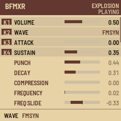

# BFXR

BFXR turns the M-VAVE FM-1 into [bfxr.net](https://www.bfxr.net)'s sound-effect maker. Turn PRESET for a coin, a
laser, an explosion, a powerup, a hit, a jump, a blip or something random; EDIT makes another of the same kind, FX
mutates it, SELECT and the four knobs edit all 32 of bfxr's parameters, and the keys play it at any pitch.

This is version {{VERSION}}. You install it at your own risk, and the installer can put M-VAVE's own firmware back.

- [Try it in the browser](emu/). It runs the same code as the FM-1, with sound.
- [Install](install/) it from Chrome or Edge, with the FM-1 connected by USB.
- The [Library](library/): the 16 sounds stored on your FM-1, played, saved as .bfxr (bfxr.net's file) or .wav,
  and .bfxr files sent back.
- [Download {{PKG}}](firmware/{{PKG}}) for the command-line installer: `python3 base/tools/fm1_install.py {{PKG}}`.
- The [Source](https://github.com/nickhelliot/Bfm-1xr) is MIT. The sound engine and generators are
  [bfxr2](https://github.com/increpare/bfxr2) by Stephen Lavelle, from Thomas Vian's SfxrSynth; it runs on
  [fm1-base](https://github.com/charlesvestal/fm1-base) and felucca-bsp, which come from Felucca by Leo Kuroshita,
  Hügelton Instruments.

M-VAVE and FM-1 are trademarks of their owners. BFXR is not affiliated with M-VAVE.
